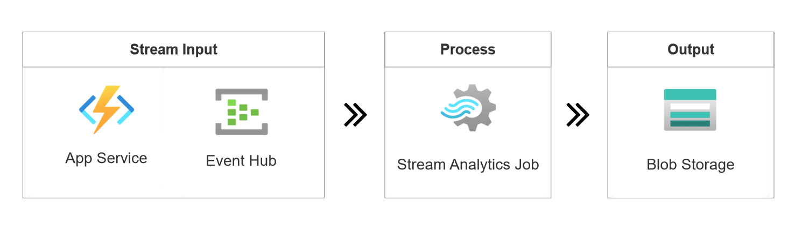

# Microsoft Azure Stream Analytics #

This repository contains data samples and data generators used for Azure Stream Analytics tutorials.

## Event generator library retirement

`WindowsAzure.ServiceBus` retired for Event Hubs on September 30, 2026 and no longer receives support or updates. Use `Azure.Messaging.EventHubs` for new event producers. For the phone-call tutorials, use [TelcoGeneratorCore](DataGenerators/TelcoGeneratorCore), which uses the current Event Hubs library and targets .NET 8.

The following examples contain the retired library and are retained as historical source, not current deployment or getting-started guidance:

| Historical example | Location |
| --- | --- |
| Security badge generator | `DataGenerators/SecurityBadgeScan` |
| Sensor event generator | `DataGenerators/SensorEventGenerator` |
| Original phone-call generator | `DataGenerators/TelcoGenerator` |
| One-click sensor solution | `Samples/ASAOneClick` |
| Security badge solution | `Samples/SecurityBadgeScan` |
| Phone-call generator UI | `Samples/TelcoDatGeneratorUI` |
| Original phone-call solution | `Samples/TelcoGenerator` |
| Tollbooth solution | `Samples/TollApp` |
| Original Twitter producer | `Samples/TwitterClient` |

Before reusing code from these directories, migrate its Event Hubs producer using the [WindowsAzure.ServiceBus migration guide](https://github.com/Azure/azure-sdk-for-net/blob/main/sdk/eventhub/Azure.Messaging.EventHubs/MigrationGuide_WindowsAzureServiceBus.md). These examples have not been migrated by this documentation update.

For more information about the Stream Analytics service, see [http://azure.microsoft.com/en-us/services/stream-analytics/](http://azure.microsoft.com/en-us/services/stream-analytics/)

## BuildApplications

This folder contains different application examples that you can choose to build a complete real-time processing application. It provides an easy way to deploy a streaming application in Azure with generated data streams. 

For example, you'll learn to extract `GET` and `POST` requests from a website clickstream and store the resulting output in Azure Blob Storage, as shown in the architecture diagram below:

